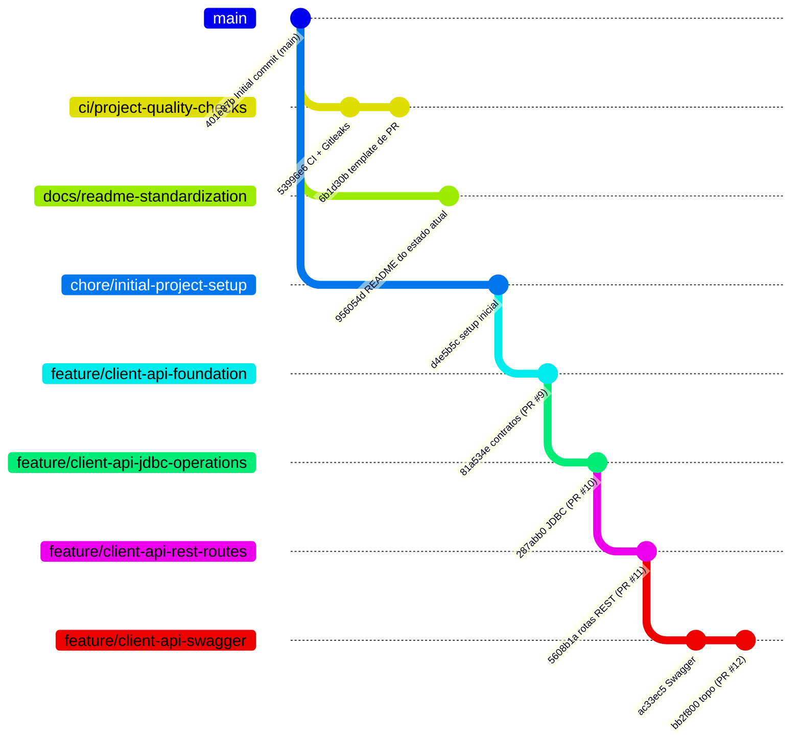
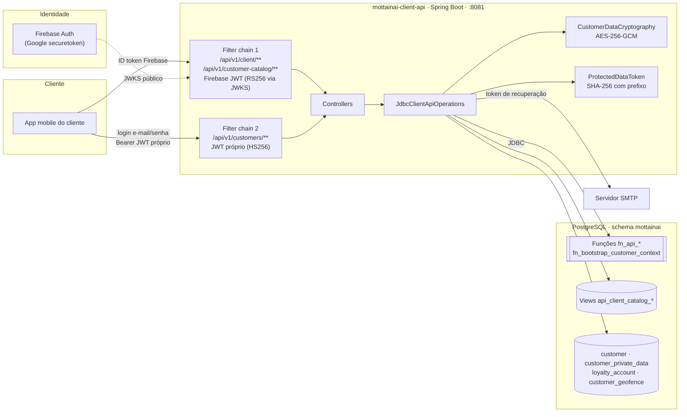
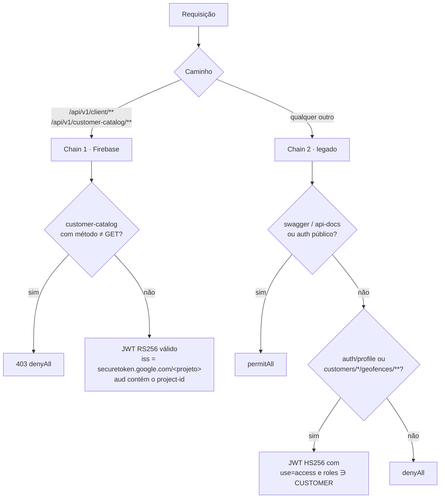

<div align="center">

# Mottainai API SQL Cliente

**API REST do aplicativo do cliente final do Mottainai: perfil, catálogo de lojas e promoções, fidelidade e geofences**

*Spring Boot sobre PostgreSQL, com acesso via funções SQL do schema `mottainai`, dados pessoais criptografados com AES-GCM e duas formas de autenticação (Firebase e JWT próprio).*

<br/>

[](#status-limitações-e-riscos)
[-orange?style=for-the-badge&logo=github)](https://github.com/Mottainai-One/Mottainai-Api-SQL-Cliente/pulls)

[](#tecnologias)
[](#tecnologias)
[](#tecnologias)
[](#autenticação-e-autorização)
[](#documentação-da-api-swagger)
[](#configuração-e-execução-local)
[](LICENSE)

<br/>

[Visão geral](#visão-geral) •
[Estado das branches](#estado-das-branches) •
[Arquitetura](#arquitetura) •
[Tecnologias](#tecnologias) •
[Endpoints](#endpoints) •
[Execução local](#configuração-e-execução-local) •
[Testes e CI](#testes-e-integração-contínua) •
[Segurança](#segurança-e-operação) •
[Riscos](#status-limitações-e-riscos)

</div>

---

> [!IMPORTANT]
> **A branch padrão `main` contém apenas o arquivo `LICENSE`.** Todo o código descrito neste README está numa cadeia de **PRs empilhadas e ainda abertas** (#9 → #10 → #11 → #12). A análise foi feita na branch do topo da pilha, `feature/client-api-swagger` @ `bb2f800`, que contém todas as anteriores. Quem clonar a `main` hoje não vai encontrar nada disso.

---

## Visão geral

| | |
|---|---|
| **Problema** | O app do cliente precisa consultar lojas e promoções próximas, manter o perfil, ver pontos de fidelidade e cadastrar alertas por proximidade, sem acesso direto ao banco operacional. |
| **Consumidor** | Aplicativo mobile do cliente (descrição no `pom.xml`: *"Standalone REST API for the Mottainai customer mobile application"*). |
| **Responsabilidade** | Expor uma API REST estreita sobre o PostgreSQL operacional, delegando regras críticas a funções SQL `mottainai.fn_api_*` e views `mottainai.api_client_catalog_*`. |
| **Escopo** | Perfil do cliente (Firebase), login legado com JWT próprio, recuperação de senha por e-mail, catálogo de lojas e promoções, saldo de fidelidade e geofences. |
| **Fora de escopo** | Criação do schema e das funções SQL (não estão neste repo), resgate de pontos e histórico de transações (o teste garante que essas rotas **não** existem), operação de loja. |

---

## Estado das branches



| PR | Branch de origem → destino | Conteúdo | Estado |
|:---:|---|---|:---:|
| #1 | `ci/project-quality-checks` → `main` | Workflow de CI, Gitleaks, validadores Python, template de PR | aberta |
| #2 | `docs/readme-standardization` → `main` | README dizendo que a `main` só tem `LICENSE` | fechada sem merge; substituída por este README |
| #9 | `feature/client-api-foundation` → `chore/initial-project-setup` | Contratos, DTOs e configuração | aberta |
| #10 | `feature/client-api-jdbc-operations` → `feature/client-api-foundation` | Implementação JDBC | aberta |
| #11 | `feature/client-api-rest-routes` → `feature/client-api-jdbc-operations` | Controllers REST | aberta |
| #12 | `feature/client-api-swagger` → `feature/client-api-rest-routes` | Swagger, `run-swagger.ps1`, teste de rotas | aberta |
| #3–#8 | `codex/*` | Versões anteriores da mesma API | fechadas, marcadas como *Superseded* |

> [!NOTE]
> A branch `chore/initial-project-setup` **não tem PR para `main`**. A pilha #9–#12 termina nela, então mesclar as quatro PRs ainda não leva o código para a `main`.

---

## Arquitetura



### Componentes

| Componente | Arquivo | Responsabilidade |
|---|---|---|
| `MottainaiClientApiApplication` | `MottainaiClientApiApplication.java` | Ponto de entrada Spring Boot |
| `SecurityConfig` | `security/SecurityConfig.java` | Duas *filter chains* stateless, decoders JWT, CORS, `BCryptPasswordEncoder` |
| `LegacyCustomerTokenService` | `security/LegacyCustomerTokenService.java` | Emite o JWT próprio (HS256) após login |
| `CustomerDataCryptography` | `security/CustomerDataCryptography.java` | Cifra e decifra dados pessoais com AES-GCM, AAD por cliente e rotação por versão de chave |
| `ProtectedDataToken` | `security/ProtectedDataToken.java` | Gera tokens determinísticos `PREFIXO_SHA256_<hex>` para nome, CPF, e-mail, telefone, UID e endereço |
| `ClientApiOperations` / `JdbcClientApiOperations` | `service/` | Contrato de casos de uso e implementação via `JdbcTemplate` e `TransactionTemplate` |
| `OpenApiConfig` | `config/OpenApiConfig.java` | Metadados OpenAPI e esquemas `FirebaseBearer` e `LegacyCustomerBearer` |
| `CustomerDataCryptoProperties` | `config/CustomerDataCryptoProperties.java` | Valida na subida que a chave é Base64 de exatamente 32 bytes |

### Objetos de banco consumidos

Nenhum desses objetos é criado por este repositório. Eles precisam existir no PostgreSQL apontado por `DB_URL`.

| Tipo | Objeto |
|---|---|
| Funções | `fn_bootstrap_customer_context`, `fn_api_bootstrap_legacy_customer_context`, `fn_api_reserve_customer_id`, `fn_api_create_firebase_customer_profile`, `fn_api_update_firebase_customer_profile`, `fn_api_customer_login`, `fn_api_request_customer_recovery`, `fn_api_validate_customer_recovery`, `fn_api_reset_customer_password`, `fn_api_clear_customer_recovery` |
| Views de catálogo | `api_client_catalog_stores`, `api_client_catalog_promotions`, `api_client_catalog_promotion_items` |
| Tabelas | `customer`, `customer_private_data`, `loyalty_account`, `customer_geofence` |

<sub>Todos no schema `mottainai`. A origem do DDL não foi confirmada neste repositório.</sub>

---

## Tecnologias

<table>
<tr>
<td align="center" width="140"><br/><b>Java 21</b><br/><sub><code>java.version</code></sub></td>
<td align="center" width="140"><br/><b>Spring Boot 4.0.0</b><br/><sub>WebMVC, JDBC,<br/>Validation, Mail</sub></td>
<td align="center" width="140"><br/><b>Spring Security</b><br/><sub>OAuth2 Resource<br/>Server (JWT)</sub></td>
<td align="center" width="140"><br/><b>PostgreSQL</b><br/><sub>Driver JDBC<br/>(runtime)</sub></td>
</tr>
<tr>
<td align="center" width="140"><br/><b>Firebase Auth</b><br/><sub>Validação de<br/>ID token via JWKS</sub></td>
<td align="center" width="140"><br/><b>springdoc 3.1.1</b><br/><sub>OpenAPI e<br/>Swagger UI</sub></td>
<td align="center" width="140"><br/><b>Maven</b><br/><sub>Build<br/>(sem wrapper)</sub></td>
<td align="center" width="140"><br/><b>JUnit + H2</b><br/><sub>Escopo de teste</sub></td>
</tr>
</table>

| Dependência | Versão | Uso |
|---|---|---|
| `spring-boot-starter-parent` | 4.0.0 | BOM e plugins |
| `spring-boot-starter-webmvc` | gerenciada pelo BOM | REST |
| `spring-boot-starter-jdbc` | gerenciada | `JdbcTemplate`, HikariCP |
| `spring-boot-starter-oauth2-resource-server` | gerenciada | Validação JWT Firebase e JWT próprio (Nimbus) |
| `spring-boot-starter-validation` | gerenciada | Jakarta Bean Validation |
| `spring-boot-starter-mail` | gerenciada | E-mail de recuperação de senha |
| `springdoc-openapi-starter-webmvc-ui` | 3.1.1 | Swagger UI |
| `org.postgresql:postgresql` | gerenciada | Driver (runtime) |
| `com.h2database:h2` | gerenciada | Escopo de teste (não usado pelos testes atuais) |

<sub>No pacote `CI` (branch `ci/project-quality-checks`): Python 3.13, Gitleaks v8.24.2 fixado por digest e GitHub Actions fixadas por SHA.</sub>

---

## Estrutura do repositório

<sub>Branch `feature/client-api-swagger`</sub>

```text
Mottainai-Api-SQL-Cliente/
├── pom.xml
├── scripts/
│   └── run-swagger.ps1                 # Sobe a API só para ver o Swagger (sem banco e sem SMTP)
└── src/
    ├── main/
    │   ├── java/com/institutojf/mottainai/client/
    │   │   ├── MottainaiClientApiApplication.java
    │   │   ├── config/                 # OpenApiConfig, CustomerDataCryptoProperties
    │   │   ├── controller/             # 5 controllers REST
    │   │   ├── dto/request/            # 10 records de entrada com Bean Validation
    │   │   ├── dto/response/           # 8 records de saída + PageResponse
    │   │   ├── security/               # SecurityConfig, JWT, criptografia, tokens protegidos
    │   │   └── service/                # ClientApiOperations + JdbcClientApiOperations
    │   └── resources/
    │       └── application.yaml        # Toda configuração sensível via variáveis de ambiente
    └── test/java/.../MottainaiClientApiApplicationTests.java
```

<sub>A branch `ci/project-quality-checks` acrescenta `.github/workflows/ci.yml`, `.github/pull_request_template.md`, `scripts/ci/check_env.py`, `scripts/ci/check_pr.py` e `tests/ci/`. Ela ainda **não** contém o código da API.</sub>

---

## Endpoints

### Autenticação e autorização



| Esquema OpenAPI | Emissor | Algoritmo | Validações |
|---|---|---|---|
| `FirebaseBearer` | Firebase Auth | RS256 (JWKS do Google) | `iss` e `aud` iguais ao `FIREBASE_PROJECT_ID`, validade padrão |
| `LegacyCustomerBearer` | Esta API (`POST /customers/auth/login`) | HS256 com `JWT_SECRET` | `iss = JWT_ISSUER`, `use = access`, `roles` contém `CUSTOMER`, expiração em `JWT_EXPIRATION_MINUTES` (padrão 60) |

### Rotas

| Método | Rota | Autenticação | Resposta | Caso de uso |
|:---:|---|:---:|:---:|---|
| `GET` | `/api/v1/client/auth/profile` | Firebase | 200 | Perfil do cliente dono do token |
| `POST` | `/api/v1/client/auth/profile` | Firebase | 201 | Cria perfil (nome, CPF, telefone, nascimento, consentimento, endereço) |
| `PUT` | `/api/v1/client/auth/profile` | Firebase | 200 | Atualiza perfil, mesclando com os dados cifrados existentes |
| `GET` | `/api/v1/client/loyalty/balance` | Firebase | 200 | Saldo de pontos da conta de fidelidade ativa |
| `GET` | `/api/v1/customer-catalog/stores` | Firebase | 200 | Lista lojas com busca por nome e raio geográfico, paginada |
| `GET` | `/api/v1/customer-catalog/stores/{id}` | Firebase | 200 | Detalhe da loja |
| `GET` | `/api/v1/customer-catalog/promotions` | Firebase | 200 | Lista promoções por loja e texto, paginada |
| `GET` | `/api/v1/customer-catalog/promotions/{id}` | Firebase | 200 | Detalhe da promoção com itens |
| `POST` | `/api/v1/customers/auth/login` | pública | 200 | Login por e-mail e senha; devolve JWT próprio |
| `POST` | `/api/v1/customers/auth/password-recovery` | pública | 204 | Solicita token de recuperação por e-mail |
| `POST` | `/api/v1/customers/auth/password-reset/validate` | pública | 200 | Valida o token de recuperação |
| `POST` | `/api/v1/customers/auth/password-reset` | pública | 204 | Troca a senha |
| `GET` | `/api/v1/customers/auth/profile` | JWT próprio | 200 | Perfil via login legado |
| `GET` | `/api/v1/customers/{customerId}/geofences` | JWT próprio | 200 | Lista geofences ativas |
| `POST` | `/api/v1/customers/{customerId}/geofences` | JWT próprio | 201 | Cria ou reativa geofence (upsert por cliente e loja) |
| `DELETE` | `/api/v1/customers/{customerId}/geofences/{geofenceId}` | JWT próprio | 204 | Desativa geofence |

### Regras de entrada confirmadas

| DTO | Regras |
|---|---|
| `CustomerStoreCatalogQuery` | `page ≥ 0` (padrão 0), `1 ≤ size ≤ 100` (padrão 20), `query` até 100 caracteres, latitude entre −90 e 90, longitude entre −180 e 180, `0 < radiusKm ≤ 500`. Latitude, longitude e raio são obrigatórios **juntos**. |
| `CustomerPromotionCatalogQuery` | `page ≥ 0`, `1 ≤ size ≤ 100`, `storeId` opcional, `query` até 100 caracteres |
| `CreateFirebaseCustomerProfileRequest` | `fullName` obrigatório, até 150; `cpf` com exatamente 11 dígitos; `phone` até 20; `birthDate` com ano entre 1900 e o ano atual (validado no serviço); `address` validado em cascata |
| `CreateAddressRequest` | `zipCode` com 8 dígitos, `state` com 2 letras maiúsculas, demais campos com tamanho máximo |
| `CreateCustomerGeofenceRequest` | `storeId` obrigatório; `50 ≤ radiusMeters ≤ 10000` |
| `CustomerLoginRequest` | `email` válido, `password` obrigatório |
| `CustomerPasswordResetRequest` | Senha de 8 a 100 caracteres, sem espaços, com minúscula, maiúscula, dígito e símbolo (regex no serviço) |
| Token de recuperação | Formato `<authId>.<43 caracteres base64url>`; formato inválido gera 400 |

### Fluxos principais

<details>
<summary><b>Busca de lojas por proximidade</b></summary>

<br/>

1. O app envia `latitude`, `longitude` e `radiusKm`.
2. O serviço monta o filtro com a fórmula de Haversine (raio da Terra de 6371,0088 km) diretamente no SQL sobre `api_client_catalog_stores`.
3. A ordenação é por `name ASC, id ASC`, com `LIMIT`/`OFFSET`.
4. A resposta segue o formato de página do Spring Data (`content`, `pageable`, `totalElements`, `totalPages` etc.), montado manualmente em `PageResponse`.

</details>

<details>
<summary><b>Criação de perfil via Firebase</b></summary>

<br/>

1. O `sub` do ID token Firebase identifica o usuário. O `email` vem da *claim* do token.
2. Numa transação, o serviço reserva um `customer_id` (`fn_api_reserve_customer_id`).
3. Nome, CPF, e-mail, telefone, UID e endereço viram tokens determinísticos `PREFIXO_SHA256_<hex>` para busca e unicidade.
4. Os dados em claro são serializados em JSON e cifrados com AES-256-GCM. A AAD é `mottainai:operational:customer.personal_data:<customer_id>`, o que impede mover o ciphertext para outro cliente.
5. `fn_api_create_firebase_customer_profile` grava tudo. Conflitos de identidade retornam **409**.

</details>

<details>
<summary><b>Recuperação de senha</b></summary>

<br/>

1. Se `CUSTOMER_PASSWORD_RECOVERY_URL`, o remetente SMTP ou o `JavaMailSender` não estiverem configurados, a rota retorna 204 **sem fazer nada**.
2. O serviço gera 32 bytes aleatórios (`SecureRandom`) e grava só o **hash BCrypt** via `fn_api_request_customer_recovery`.
3. Se o e-mail existir, o token `<authId>.<segredo>` é enviado **depois do commit** da transação. Se não existir, a resposta é a mesma (204).
4. Se o envio falhar, o token é invalidado com `fn_api_clear_customer_recovery`. O log registra só o `authId` e o tipo do erro.
5. `password-reset/validate` e `password-reset` verificam formato, complexidade e delegam a validação do segredo ao banco.

</details>

<details>
<summary><b>Geofences e controle de dono</b></summary>

<br/>

`requireLegacyOwner` resolve o `customer_id` a partir do *subject* do JWT (e-mail protegido) e compara com o `{customerId}` da URL. Se forem diferentes, responde **404** em vez de 403, sem confirmar que o cliente existe. A criação é um `INSERT ... ON CONFLICT (customer_id, store_id) DO UPDATE`, ou seja, idempotente por par cliente e loja.

</details>

---

## Configuração e execução local

### Pré-requisitos

- [ ] JDK **21** (o `run-swagger.ps1` recusa outras versões)
- [ ] Maven **3.9.16 ou superior** (não há `mvnw` versionado)
- [ ] PostgreSQL com o schema `mottainai` e as funções e views listadas em [Objetos de banco](#objetos-de-banco-consumidos)
- [ ] Projeto Firebase, para as rotas `/client/**` e `/customer-catalog/**`
- [ ] SMTP, apenas se for testar recuperação de senha

### Variáveis de ambiente

| Variável | Obrigatória | Padrão | Uso |
|---|:---:|:---:|---|
| `DB_URL` | sim | — | URL JDBC do PostgreSQL |
| `DB_USER` | sim | — | Usuário do banco |
| `DB_PASSWORD` | sim | — | Senha do banco |
| `SERVER_PORT` | não | `8081` | Porta HTTP |
| `FIREBASE_PROJECT_ID` | sim | — | Valida `iss` e `aud` do token Firebase |
| `JWT_SECRET` | sim | — | Chave HS256 do JWT próprio, em **Base64** |
| `JWT_ISSUER` | sim | — | `iss` do JWT próprio |
| `JWT_EXPIRATION_MINUTES` | não | `60` | Validade do JWT próprio |
| `CUSTOMER_DATA_ENCRYPTION_KEY` | sim | — | Base64 de exatamente 32 bytes (AES-256) |
| `CUSTOMER_DATA_KEY_VERSION` | não | `1` | Versão da chave ativa (1 a 32767) |
| `CUSTOMER_DATA_DECRYPTION_KEYS` | não | vazio | Chaves antigas para rotação, no formato `versão:base64,...` |
| `STAFF_DATA_ENCRYPTION_KEY` | sim | — | Usada só para garantir que a chave de cliente é **diferente** da de funcionários |
| `CUSTOMER_PASSWORD_RECOVERY_URL` | não | vazio | Página de recuperação citada no e-mail. Vazio desativa o fluxo. |
| `MAIL_HOST`, `MAIL_PORT`, `MAIL_USERNAME`, `MAIL_PASSWORD` | não | porta `587` | SMTP. `MAIL_USERNAME` também é o remetente. |
| `MAIL_SMTP_AUTH`, `MAIL_SMTP_STARTTLS` | não | `true` | Opções SMTP |
| `SECURITY_CORS_ALLOWED_ORIGINS` | não | vazio | Origens CORS separadas por vírgula (propriedade `security.cors.allowed-origins`) |

> [!CAUTION]
> Não versione `.env` nem valores dessas variáveis. A branch de CI rejeita arquivos `.env*` (exceto `.env.example`, `.env.sample` e `.env.template`) e roda o Gitleaks no histórico.

### Executar com banco

```bash
git checkout feature/client-api-swagger
# exporte as variáveis obrigatórias da tabela acima
mvn spring-boot:run
```

A aplicação sobe mesmo sem o banco disponível (`hikari.initialization-fail-timeout: -1`). Nesse caso, as rotas de negócio falham na primeira consulta.

### Documentação da API (Swagger)

Em Windows, `scripts/run-swagger.ps1` sobe a API **apenas para ver a documentação**:

```powershell
.\scripts\run-swagger.ps1
```

| O que o script faz | Detalhe |
|---|---|
| Valida o Java | Exige versão 21 |
| Localiza o Maven | `.tools/apache-maven-3.9.16`, `mvn` no PATH ou cache do wrapper em `~/.m2` |
| Desliga o banco | Aponta `DB_URL` para a porta 1 de `127.0.0.1` com credenciais fictícias |
| Gera chaves locais | Chaves aleatórias de 32 bytes, só em memória, quando as variáveis não estão definidas |
| Desliga o SMTP | Variáveis de e-mail vazias |

Endereços: `http://localhost:8081/swagger-ui.html` e `http://localhost:8081/v3/api-docs`.

---

## Testes e integração contínua

### Testes da aplicação

| Teste | O que verifica |
|---|---|
| `openApiConfigDefinesBothBearerSchemes` | O OpenAPI declara `FirebaseBearer` e `LegacyCustomerBearer` |
| `approvedClientRoutesAreMappedAndRemovedLoyaltyRoutesStayAbsent` | Via reflexão, os controllers têm os caminhos e métodos HTTP esperados, e `ClientLoyaltyController` **não** tem `transactions` nem `redeem` |

```bash
mvn test
```

> [!WARNING]
> Os testes não sobem o contexto Spring, não usam MockMvc nem banco. O H2 está no `pom.xml` mas nenhum teste o utiliza. **Segurança, SQL, criptografia e validações não têm teste automatizado.**

### CI (branch `ci/project-quality-checks`, PR #1)

| Job | Gatilho | O que faz |
|---|---|---|
| `checklist` (5 checks em matriz) | `pull_request` | Exige que a descrição da PR marque cada critério: compila, testes passam, aplicação inicia, sem `.env`/segredos, dependências instaláveis. Ignora itens em comentários HTML e blocos de código. |
| `secrets` | push, PR, manual | Gitleaks v8.24.2 (imagem fixada por digest) no histórico completo, com `--redact` |
| `python` | push, PR, manual | `python -m unittest discover -s tests/ci -v` (Python 3.13) |
| `environment-files` | push, PR, manual | `scripts/ci/check_env.py` rejeita arquivos `.env*` versionados |

Boas práticas já presentes: `permissions: contents: read`, actions fixadas por SHA, `persist-credentials: false`, `timeout-minutes` e `concurrency` com cancelamento.

> [!IMPORTANT]
> O checklist é uma **declaração** de quem abre a PR, não uma prova. Não existe job de `mvn verify` nessa CI, porque ela foi escrita quando a `main` só tinha `LICENSE`. O próprio README da branch diz isso.

---

## Segurança e operação

| Tema | Implementação observada |
|---|---|
| Sessão | Stateless, CSRF desligado (adequado para API com Bearer) |
| Rotas não mapeadas | `denyAll` por padrão nas duas chains |
| Escrita no catálogo | Bloqueada (`denyAll` para métodos diferentes de `GET`) |
| Senhas | No login, a comparação é delegada à função `fn_api_customer_login` (algoritmo não confirmado aqui). O token de recuperação e a nova senha recebem BCrypt na API antes de ir ao banco. |
| Dados pessoais | AES-256-GCM com nonce de 12 bytes, tag de 128 bits, AAD por cliente e versionamento de chave |
| Separação de chaves | A subida falha se a chave de cliente for igual à de funcionários |
| Erros | `server.error.include-message: never` e `include-stacktrace: never` |
| Logs | Só `authId` e tipo da exceção no fluxo de e-mail; nenhum dado pessoal encontrado em log |
| CORS | Lista explícita, sem credenciais, cabeçalhos `Authorization`, `Content-Type` e `Idempotency-Key` |
| SQL | Parâmetros posicionais (`?`) no `JdbcTemplate`; nenhuma concatenação de entrada do usuário observada |

Deploy, Dockerfile, monitoramento, health check e rollback: **não confirmados no repositório**. Também não há Spring Boot Actuator nas dependências.

---

## Status, limitações e riscos

| Item | Status |
|---|:---:|
| Código da API |  |
| Código na `main` |  |
| CI de segurança (Gitleaks, `.env`) |  |
| Build e testes na CI |  |
| Testes de integração |  |
| DDL das funções SQL |  |
| Dockerfile e deploy |  |

> [!WARNING]
> **Riscos técnicos observados**
> 1. **Pilha de PRs sem caminho para a `main`.** A base de #9 é `chore/initial-project-setup`, que não tem PR para `main`. Além disso, as PRs #1 (CI) e #12 (código) nunca se encontraram: a CI não roda sobre o código.
> 2. **Tokens determinísticos sem segredo.** `ProtectedDataToken` usa SHA-256 puro, sem *pepper* nem HMAC. CPF tem espaço de busca pequeno, então quem tiver acesso de leitura ao banco consegue recuperar CPFs por força bruta. Um HMAC com chave fora do banco resolveria.
> 3. **Senha em claro como parâmetro SQL.** O login envia a senha para `fn_api_customer_login`. Se o PostgreSQL registrar parâmetros (`log_statement`, `auto_explain`, erros), a senha pode aparecer em log do banco.
> 4. **Dois modelos de identidade.** Fidelidade e catálogo exigem Firebase, mas geofences exigem o JWT próprio. O app precisa manter as duas sessões. Isso não está documentado como decisão.
> 5. **Sem *rate limit* na API** para login e recuperação de senha. Se existe bloqueio por tentativas, ele está na função SQL, não confirmada aqui.
> 6. **Enumeração por tempo.** O e-mail de recuperação é enviado de forma síncrona só quando a conta existe, o que deixa a resposta mais lenta nesse caso.
> 7. **`Idempotency-Key`** é aceito pelo CORS, mas nenhum código o utiliza.

---

## Referências

- Repositório: <https://github.com/Mottainai-One/Mottainai-Api-SQL-Cliente>
- PRs da pilha: [#9](https://github.com/Mottainai-One/Mottainai-Api-SQL-Cliente/pull/9), [#10](https://github.com/Mottainai-One/Mottainai-Api-SQL-Cliente/pull/10), [#11](https://github.com/Mottainai-One/Mottainai-Api-SQL-Cliente/pull/11), [#12](https://github.com/Mottainai-One/Mottainai-Api-SQL-Cliente/pull/12)
- PR de CI: [#1](https://github.com/Mottainai-One/Mottainai-Api-SQL-Cliente/pull/1)
- Firebase: [Verify ID tokens using a third-party JWT library](https://firebase.google.com/docs/auth/admin/verify-id-tokens#verify_id_tokens_using_a_third-party_jwt_library)
- springdoc-openapi: <https://springdoc.org/>

---

<div align="center">

**Mottainai** · *menos desperdício, mais inteligência no estoque*

<sub>Parte do ecossistema <a href="https://github.com/Mottainai-One">Mottainai-One</a></sub>

</div>

---

<sub>**Rastreabilidade.** Análise em 2026-10-27. `main` @ `401e87b` (só `LICENSE`). Código analisado em `feature/client-api-swagger` @ `bb2f800`: `pom.xml`, `.gitignore`, `application.yaml`, `scripts/run-swagger.ps1`, os 5 controllers, `ClientApiOperations`, `JdbcClientApiOperations`, `SecurityConfig`, `CustomerDataCryptography`, `LegacyCustomerTokenService`, `ProtectedDataToken`, `OpenApiConfig`, `CustomerDataCryptoProperties`, DTOs de entrada e `MottainaiClientApiApplicationTests`. CI analisada em `ci/project-quality-checks` @ `6b1d30b`: `ci.yml`, `check_env.py`, `check_pr.py`, `README.md`, `.gitignore`. Lista de PRs pela API pública do GitHub.</sub>
